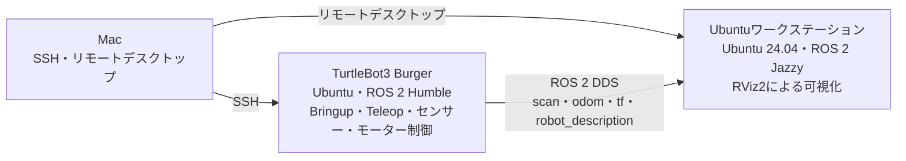

# TurtleBot3 Spatial AI

TurtleBot3 Burger に搭載した 2D LiDAR と RGB-D カメラで、観測した物体を **位置・意味・空間関係・観測履歴** を持つ Spatial Scene Graph として構築し、LLM による自然言語指示からの物体特定と Nav2 によるナビゲーションを行うプロジェクトです。

## ドキュメント

- [設計書](docs/design_doc.md)
- [研究計画書](docs/research_plan.md)（[PDF](docs/research_plan.pdf)）

## ステータス

実装前の設計段階です。

## 現在の実機構成

最終確認日：2026年11月9日

| 機器 | 役割 |
|---|---|
| TurtleBot3 Burger | LiDARやオドメトリなどのデータを配信し、モーターを制御する。Bringupとキーボード操作を実行する |
| Ubuntuワークステーション | TurtleBot3のトピックを受信し、RViz2でロボット、LiDAR、TF、オドメトリを表示する |
| Mac | TurtleBot3へSSHで接続する。Ubuntuワークステーションはリモートデスクトップで操作する |

TurtleBot3とUbuntuワークステーションは同じネットワーク上でROS 2のDDS通信を行う。送信先のIPアドレスをTurtleBot3へ個別に設定する必要はない。
