# 全体像とROS 2の仕組み

最終更新日：2026年11月18日

この文書は、デモのゴールに向けたシステムの全体像と、その土台にあるROS 2、Gazebo、TurtleBot3 Burger、Meta Quest 3の仕組みを図で説明する。詳しい仕様は [design_doc.md](design_doc.md)、作業の順番は [todo.md](todo.md) にある。

## 目指すデモ

1. ロボットが部屋を走り、2D LiDARのSLAMで地図を作る
2. RGB-DカメラとYOLOで机・椅子・植物などを見つけ、`map`座標での位置を推定する
3. 同じ物体を何度見ても1つのノードにまとめ、`NEAR`（近い）と`IN_ROOM`（どの部屋にあるか）の関係をNeo4jに保存する
4. 「観葉植物の近くの椅子に行って」と頼むと、LLMがグラフを検索して対象を特定する
5. Nav2が安全に到達できるゴールを確かめてから移動する
6. 最後に、地図・物体・関係・経路をMeta Quest 3のMR表示で重ねて見る

---

## 1. 全体像

実機とGazeboは、**同じトピック名・同じ型**でデータを出すように揃える。上位の処理（SLAM、認識、グラフ、Nav2）は、どちらにつながっているかを意識しない。

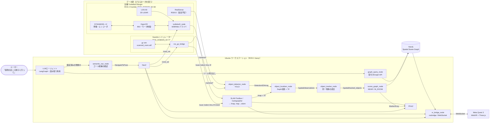

### 処理の分担

| 場所 | 担当すること | 担当しないこと |
|---|---|---|
| TurtleBot3（Raspberry Pi 4） | センサーの読み取り、モータへの速度指令 | 物体認識、SLAMの重い計算、LLM |
| ワークステーション | SLAM、物体認識、グラフ構築、Nav2、LLM | モータの直接制御 |
| Neo4j | 物体・関係・観測履歴の保存と検索 | 推論 |
| LLM | 質問を構造化し、Graph APIで対象を探す | `/cmd_vel`の発行、DBへの書き込み |
| Quest 3 | 状態の表示、のちに物体の選択と移動の承認 | ロボットの直接操作 |

### デモの流れ（ステップ4〜6）

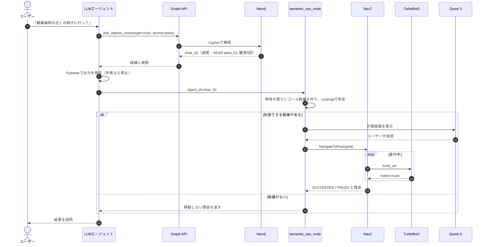

---

## 2. ROS 2の仕組み

### 2.1 レイヤー構造

ROS 2は、自前で通信を実装していない。下の**DDS**という通信規格のミドルウェアに通信を任せ、`rmw`という層で差し替えられるようにしている。

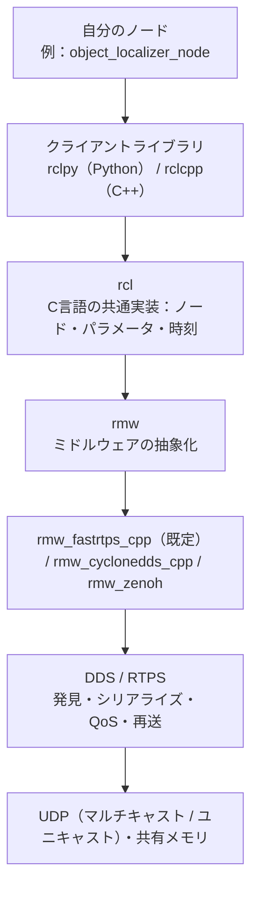

- このリポジトリの実機設定では `RMW_IMPLEMENTATION=rmw_fastrtps_cpp`（Fast DDS）を使っている。
- 送受信する両側で同じRMWを使うのが安全。混ぜると発見はできても通信が不安定になることがある。

### 2.2 ノードの発見（Discovery）とROS_DOMAIN_ID

ROS 2には、ROS 1の`roscore`のような中央サーバーがない。各ノードがネットワークに「自分はここにいて、このトピックを出している」と告知し合い、互いを見つける。

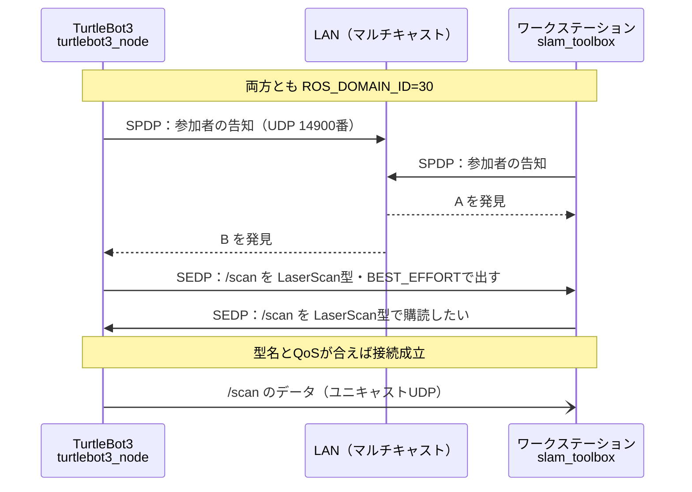

- **ROS_DOMAIN_ID** は、使うUDPポート番号を変える。発見用マルチキャストのポートは `7400 + 250 × ドメインID` で、30なら14900番、77なら26650番。**ドメインIDが違うノード同士は互いに見えない**。実機（30）とシミュレーター（77）を分けているのはこのため。
- `ROS_LOCALHOST_ONLY=0` は自分のPCの外とも通信するという設定（Humble）。Jazzyでは代わりに `ROS_AUTOMATIC_DISCOVERY_RANGE=SUBNET` を使う。今の構成は両方を設定しているので、HumbleとJazzyのどちらの側でも意図どおりに動く。
- マルチキャストを通さないWi-Fiルーターでは発見に失敗する。その場合はFast DDSのDiscovery Serverか、ピアのIPアドレスの明示指定を使う。

> **注意：** 実機はHumble、ワークステーションはJazzyで、ディストリビューションが違う。ROS 2はディストリビューションをまたぐ通信を公式にはサポートしていない。`LaserScan`や`Odometry`のような変更のない標準メッセージは通じることが多いが、型の定義が変わったメッセージは通じない。うまくいかないときは、まずこの差を疑う。

### 2.3 通信の4つの形

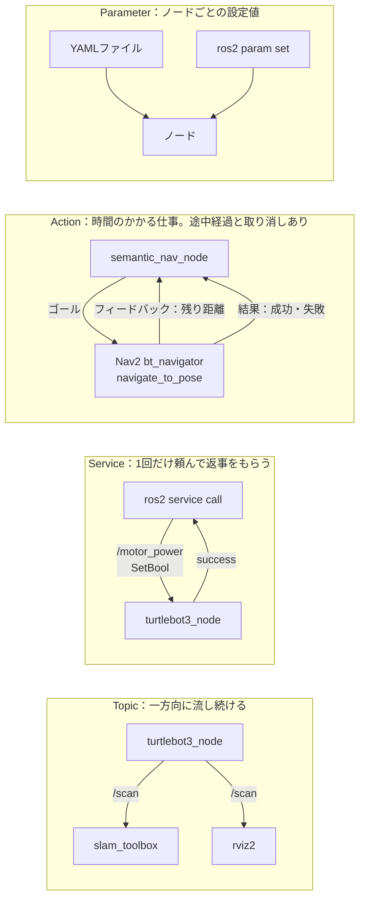

| 形 | 使う場面 | このプロジェクトでの例 |
|---|---|---|
| Topic | センサー値や速度指令のように、流し続けるもの | `/scan`、`/odom`、`/cmd_vel`、`/map` |
| Service | すぐ終わる要求と応答 | `/motor_power`、地図の保存 |
| Action | 時間がかかり、途中経過や取り消しが要るもの | Nav2の`navigate_to_pose` |
| Parameter | 起動時や実行中に変える設定 | SLAMの解像度、Nav2の速度上限 |

### 2.4 QoS（通信品質の設定）

送信側と受信側のQoSが合わないと、**エラーも出ずにデータが届かない**。RViz2で何も表示されないときの典型的な原因。

| 項目 | 選択肢 | 使い分け |
|---|---|---|
| Reliability | `RELIABLE`：届くまで再送する<br/>`BEST_EFFORT`：落ちても再送しない | センサーは`BEST_EFFORT`。古い値を再送するより新しい値が大事なため |
| Durability | `VOLATILE`：後から来た購読者には過去分を送らない<br/>`TRANSIENT_LOCAL`：最後の値を取っておき、後から来た購読者にも送る | `/map`と`/robot_description`は`TRANSIENT_LOCAL`。1回しか出さないことがあるため |
| History / Depth | 何件まで溜めるか | 画像は小さく、制御は1〜10程度 |

組み合わせの規則：送信側が`BEST_EFFORT`で受信側が`RELIABLE`だと接続しない。逆なら接続する。Durabilityも同じで、受信側が`TRANSIENT_LOCAL`を求めて送信側が`VOLATILE`だと接続しない。RViz2でLaserScanのReliabilityを`Best Effort`に、RobotModelのDurabilityを`Transient Local`にしたのはこの規則のため。

確認するコマンド：

```bash
ros2 topic info -v /scan    # 送信側と受信側のQoSが両方見える
```

### 2.5 TF2（座標変換）

ロボットの各部品の位置関係と、ロボットが地図のどこにいるかを、**時刻つきの木構造**で管理する。

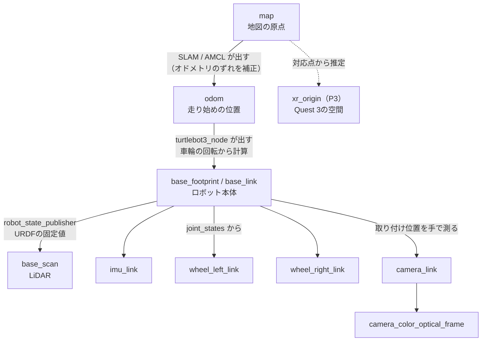

- `odom → base_link`はなめらかだが、走るほどずれがたまる。`map → odom`はSLAMが地図との照合でずれを打ち消す。この2段構えにすることで、制御はなめらかなまま、地図上の位置も正しく保てる。
- 物体の位置を`map`座標に直すときは、**画像を撮った時刻のTF**を使う。最新のTFを使うと、走行中に位置がずれる。
- SLAM Toolboxのログに出た「TF待ちのキューが満杯でスキャンを破棄」は、`/scan`の時刻に対応する`odom → base_link`がまだ届いていない、という意味。ネットワークの遅延か、PC同士の時計のずれ（`chrony`で合わせる）が原因の候補になる。

### 2.6 時刻：実時間とシミュレーション時間

- 実機では、各PCのシステム時計を使う。PC同士の時計がずれるとTFの照合に失敗するので、NTP（`chrony`）で揃える。
- Gazeboでは、シミュレーターが`/clock`トピックで時刻を配信する。全ノードを`use_sim_time:=True`で起動し、この時刻に従わせる。実機で`use_sim_time:=True`にすると、時刻が進まずに止まる。

### 2.7 launchとlifecycle

- **launch**：複数のノードを、パラメータやトピック名の付け替え（remap）と一緒にまとめて起動するPythonスクリプト。`ros2 launch turtlebot3_bringup robot.launch.py`がその例。
- **lifecycle node**：`未設定 → 設定済み → 動作中`と状態を持つノード。Nav2の各サーバーはこれで、`lifecycle_manager`が地図やTFの準備ができた順に起動する。Nav2が動かないときは、どのノードが`active`になっていないかを最初に見る。

---

## 3. TurtleBot3 Burgerのセンサー出力と制御

### 3.1 ハードウェアとソフトウェアのつながり

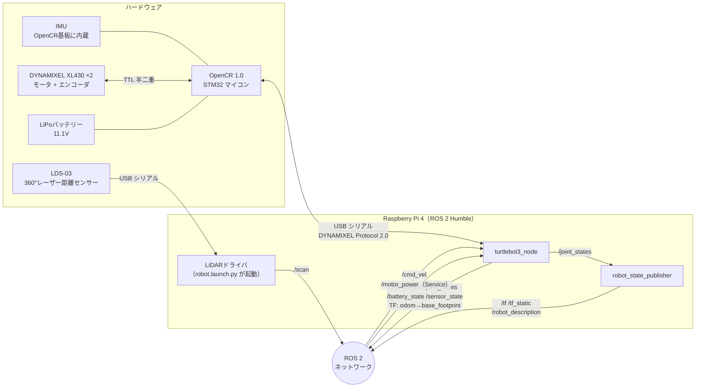

- OpenCRは、Raspberry Piから見ると「DYNAMIXELの1台」のようにふるまう。`turtlebot3_node`は、OpenCRのコントロールテーブル（メモリの番地表）に目標速度を書き込み、エンコーダ値やIMU値を読み出す。
- OpenCRのファームウェアが、モータを決まった周期で制御する。Raspberry PiはROS 2の世界とのつなぎ役。

### 3.2 センサー出力

| トピック | 型 | 中身 | 出し手 |
|---|---|---|---|
| `/scan` | `sensor_msgs/LaserScan` | 360°の距離配列（`ranges`）、角度の始点・刻み、測定範囲。実機では400点 | LiDARドライバ |
| `/odom` | `nav_msgs/Odometry` | 位置・姿勢（`pose`）と速度（`twist`）、共分散 | `turtlebot3_node` |
| `/imu` | `sensor_msgs/Imu` | 姿勢の四元数、角速度、加速度 | `turtlebot3_node` |
| `/joint_states` | `sensor_msgs/JointState` | 左右の車輪の回転角と角速度 | `turtlebot3_node` |
| `/battery_state` | `sensor_msgs/BatteryState` | 電圧・残量 | `turtlebot3_node` |
| `/sensor_state` | `turtlebot3_msgs/SensorState` | バンパー、ボタン、エンコーダの生の値など | `turtlebot3_node` |
| `/tf`、`/tf_static` | `tf2_msgs/TFMessage` | 座標変換（2.5節） | `turtlebot3_node`、`robot_state_publisher` |

**SLAMが「401点を期待」と出した件：** `LaserScan`は`angle_min`、`angle_max`、`angle_increment`から点数を計算できる。SLAM Toolboxは`(angle_max − angle_min) / angle_increment + 1`で点数を見積もるため、ドライバの角度設定によって、実際の点数（400）と1点ずれることがある。LDS-03のドライバの設定値と、SLAM Toolboxの対応を確かめる必要がある。

### 3.3 制御：`/cmd_vel`から車輪まで

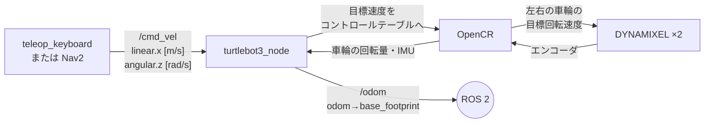

Burgerは差動二輪（左右の車輪の速度差で曲がる）。車輪の半径を r = 0.033 m、左右の車輪の間隔を L = 0.160 m とすると、

```text
指令から車輪の速度へ：
  v_left  = v − ω · L / 2
  v_right = v + ω · L / 2
  （車輪の回転速度 = v_left / r, v_right / r）

車輪の回転からオドメトリへ（短い時間 Δt ごと）：
  v  = (v_right + v_left) / 2
  ω  = (v_right − v_left) / L
  x += v · cos(θ) · Δt
  y += v · sin(θ) · Δt
  θ += ω · Δt
```

- Burgerの速度上限は、直進0.22 m/s、旋回2.84 rad/s。これを超える指令は切り詰められる。
- オドメトリは、タイヤが滑ると誤差がたまる。これを地図との照合で補正するのがSLAMやAMCL（2.5節の`map → odom`）。
- `/cmd_vel`の型は、構成によって`Twist`と`TwistStamped`が分かれる。Jazzy側のNav2が出す型と、Humble側の`turtlebot3_node`が受ける型を、`ros2 topic info -v /cmd_vel`で必ず確かめる。型が合わないと、エラーなしで動かない。
- 安全：`/motor_power`を有効にする前に、速度ゼロの`/cmd_vel`を送る（[work_history.md](../work_history.md)）。

---

## 4. Gazeboシミュレーター

実機のかわりに、同じトピックを出す仮想のロボットを動かす。実機の地図から部屋を作ると（`sim/`）、実機とシミュレーターで同じ部屋を使える。

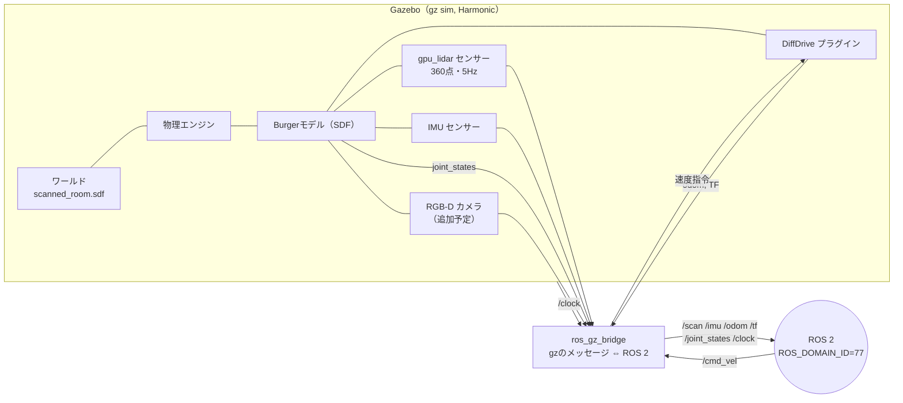

| | 実機 | Gazebo |
|---|---|---|
| `ROS_DOMAIN_ID` | 30 | 77 |
| 時刻 | システム時計（`use_sim_time:=False`） | `/clock`（`use_sim_time:=True`） |
| `/scan` | LDS-03（実測400点、ノイズあり） | gpu_lidar（`sim/models/burger/model.sdf`で360点・5Hz） |
| オドメトリ | エンコーダから。滑りの誤差あり | DiffDriveプラグインから。ほぼ理想値 |
| `/cmd_vel`の受け手 | `turtlebot3_node` | DiffDriveプラグイン（`Twist`型。`sim/config/burger_bridge.yaml`） |
| カメラ | RealSense（追加予定） | まだモデルにない |

- シミュレーターは誤差が小さいので、うまくいっても実機で同じとは限らない。違いは`docs/environment.md`に記録する（todo Step 0）。
- 今のシミュレーターのLiDARは360点で、実機の400点と違う。点数やノイズを実機に寄せておくと、「401点問題」のようなずれをシミュレーターでも再現できる。

---

## 5. Meta Quest 3との接続（第3回）

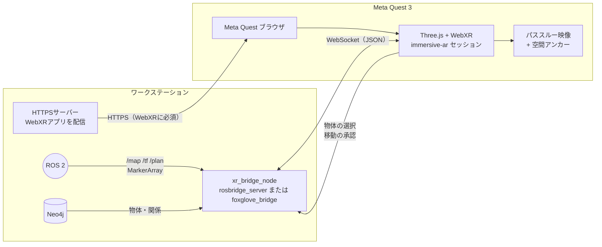

### 座標系の違い

| | ROS（REP 103） | WebXR / Three.js |
|---|---|---|
| 手系 | 右手系 | 右手系 |
| 上向き | +Z | +Y |
| 前向き | +X | −Z |
| 単位 | m | m |

`map`座標の点をQuest 3に表示するには、2段の変換をする。

1. **軸の付け替え**：ROSの(x, y, z)を、WebXRの(−y, z, −x)にする（固定の回転）。
2. **位置合わせ**：部屋の中の3点以上の対応点（またはAprilTag）から、`map`とQuest 3の空間の間の回転と平行移動を推定する。誤差は実際に測って記録する（todo Step 3-2）。

最初はQuest 3のブラウザで2D表示を見るところから始め、次にWebXRで現実の部屋に重ねる（[design_doc.md](design_doc.md) 8.2節）。

---

## 6. 今どこにいるか

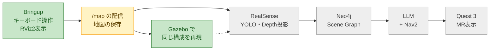

| 段階 | 状態 |
|---|---|
| Bringup、キーボード操作、RViz2でのRobotModel表示 | 動作確認済み |
| `/map`の配信と地図の保存 | 止まっている（TFの待ち、LiDARの点数のずれ） |
| Gazebo | 実機の地図からワールドを作るシミュレーター（`sim/`）はPR #2でマージ済み。Nav2はまだ動かしていない |
| 物体認識からQuest 3まで | 未着手 |
