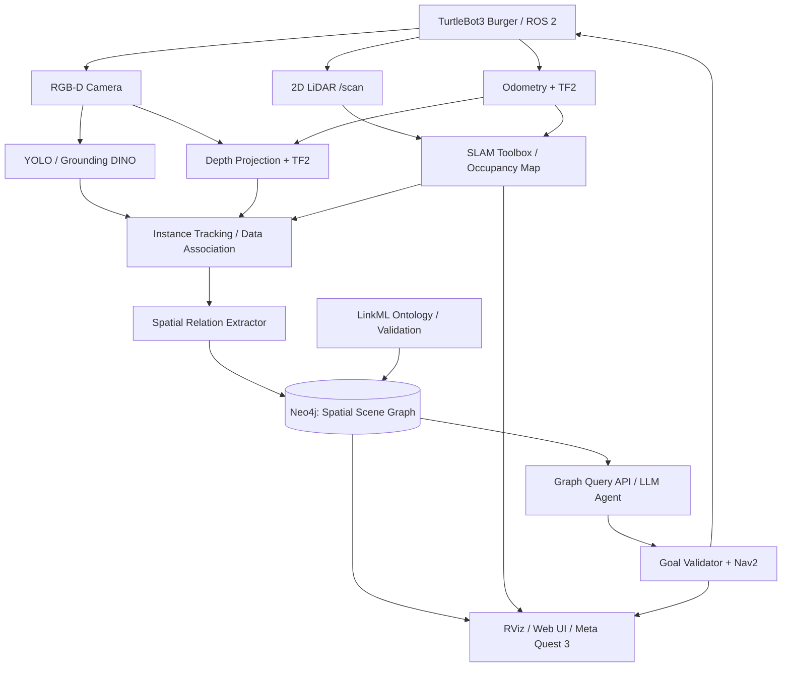

# TurtleBot3 Spatial AI Lab — 設計書（design.md）

> **プロジェクト名:** `turtlebot-spatial-ai`  
> **テーマ:** ROS 2 × 2D LiDAR × RGB-D Camera × Semantic SLAM × Spatial Scene Graph × Knowledge Graph × LLM × Meta Quest 3  
> **対象:** TurtleBot3 Burger / ROS 2 / 室内移動ロボット  
> **作成日:** 2026-11-03  
> **ステータス:** 実装前の設計案（機種・OS・センサー接続は現物確認して確定）

## 0. この文書の目的

本書は、TurtleBot3 Burgerに搭載した2D LiDARとカメラを利用して、ロボットが観測した物体を**位置・意味・物体間の関係**として保持するSpatial Scene Graphを構築し、それを知識グラフ・生成AI・ROS 2 Navigation 2（Nav2）・Meta Quest 3で利用するデモの実装仕様である。

主目的は次の3点とする。

1. **勉強会デモ:** ロボットが探索するにつれてScene Graphが成長し、自然言語で問い合わせ・移動できることを見せる。
2. **技術ブログ:** SLAM、物体認識、センサーフュージョン、Scene Graph、LLM/GraphRAG、XRを、再現可能なコードと測定結果で解説する。
3. **大学院の研究準備:** 物体間関係の導入が自然言語の対象特定・探索成功率を改善するかを、ベースラインと比較して検証する。

### 0.1 デモで実現するユーザーストーリー

- ロボットが部屋を走行し、2D SLAMで占有格子地図（Occupancy Grid）を作る。
- カメラで机、椅子、植物などを認識し、3D位置を推定する。
- 同一物体の再観測を統合し、物体ノードと `NEAR`、`IN_ROOM` などのエッジを作る。
- ユーザーが「観葉植物の近くにある椅子を探して」と質問すると、対象を特定する。
- 安全確認された目標地点をNav2に送り、近くまで走行する。
- 最終的に、地図・物体・関係線・経路をQuest 3のXR表示で観察する。

### 0.2 明確に区別する概念

| 概念 | 本プロジェクトでの役割 |
| --- | --- |
| 2D SLAM / Metric Map | 壁・障害物とロボット位置を推定する。物体の意味は表現しない。 |
| Semantic Map | 地図に物体カテゴリ・インスタンス・位置を結びつける。 |
| Spatial Scene Graph | 観測した物体・部屋・場所をノードとし、空間関係をエッジで表現する。 |
| Knowledge Graph | Scene Graphに加え、分類体系、機能、制約、概念間の関係を管理する。 |
| Ontology | ノードやエッジの型、語彙、制約を定義する。LinkMLを採用する。 |
| LLM / GraphRAG | グラフから根拠情報を取得し、自然言語の質問を解釈し行動候補を構成する。 |
| Nav2 | 通行可能性の判定、経路計画、障害物回避、移動実行を担当する。 |

**重要:** MVPでは「2D地図上に射影した物体インスタンスと空間関係」を扱う。これはフル3D Scene Graphの完成を意味しない。物体の高さ、支持関係（`ON_TOP_OF`）、遮蔽、部屋の区切りの自動認識などは後段で強化する。

---

## 1. スコープと達成条件

### 1.1 MVPの必須範囲（P0–P1）

- ROS 2の`/scan`、`/odom`、`/tf`、カメラ画像・Depthトピックを取得できる。
- `slam_toolbox`で2D地図を作成し、保存・再読込できる。
- 指定した3種類以上の物体（例：chair / table / plant）を検出する。
- RGB-DとTF2から物体の代表位置（`map`座標系）を推定する。
- 同じ物体を複数回観測しても、原則1つのノードに統合できる。
- `Room`、`Object`ノード、および`IN_ROOM`、`NEAR`エッジを生成できる。
- Neo4jに保存し、RVizとWeb画面で確認できる。
- 再現可能なrosbag2サンプルと検証用アノテーションを残せる。

### 1.2 拡張範囲（P2–P3）

- LLMに自然言語で物体間関係を問い合わせる。
- 同名物体を区別したうえで、対象付近の安全な到達候補を計算しNav2で移動する。
- 椅子等を移動した場合、観測履歴と関係を更新する。
- Meta Quest 3から、実空間と整合した2D/3D可視化および移動目標設定を行う。

### 1.3 非目標（MVPでは実装しない）

- 人物の顔認識・本人識別・行動追跡。
- LLMによる直接の`/cmd_vel`操作。
- 3Dメッシュの完全再構築、3DGS生成、Hydra/ConceptGraphsの完全再実装。
- 複数階ナビゲーション、開閉ドアの自動操作、ロボットアームによる把持。
- 完全自律の未知空間探索（最初は遠隔操作または既知の経路で収集する）。

---

## 2. ハードウェア・動作環境

| 機材 | 役割 | 配置・備考 |
| --- | --- | --- |
| TurtleBot3 Burger | 差動二輪ベース、車輪オドメトリ、モータ制御 | 移動プラットフォーム |
| 2D LiDAR | `/scan`による計測 | 標準搭載LiDAR、ドライバとTFの動作確認が前提 |
| Raspberry Pi 4 | センサー受信と低レベルROS 2処理 | 重い認識・LLM推論は載せない |
| RealSense D435i / D455 | RGB、Depth、カメラ内部パラメータ | いずれか1台。固定具、給電、USB帯域、視野を確認 |
| Ubuntu PC / GPU PC | SLAM / YOLO / グラフ処理 / Nav2 / LLM | ネットワーク越しのROS 2ノード |
| Meta Quest 3 | XR可視化・操作（P3） | WebXRまたはUnityを比較 |

**バージョン方針:** 初期実装は既存のUbuntu 22.04であればROS 2 Humbleを第一候補とする。Ubuntu 24.04へ移行する場合はJazzyを別プロファイルとし、TurtleBot3とRealSenseの対応を確認してから切り替える。ドライバAPI・依存パッケージ・OS組合せは固定し、動作確認済みの値を`docs/environment.md`に記録する。

### 2.1 初期接続確認

```bash
# 別ターミナルでTurtleBot3のbringupを起動した後に確認
ros2 node list
ros2 topic list
ros2 topic hz /scan
ros2 topic echo /scan --once
ros2 topic echo /odom --once
ros2 run tf2_ros tf2_echo odom base_link

# カメラトピック名は実際のドライバ設定に合わせる
ros2 topic list | grep -E 'camera|image|depth|camera_info'
ros2 doctor --report
```

> **着手条件:** 以前の環境では`/scan`が出力されていなかったため、SLAM以前にLiDARドライバ、電源、通信、frame ID、QoSを確認する。実機でデータが出ない間は、rosbag2またはGazeboのデータで開発を進める。

---

## 3. 全体アーキテクチャ



### 3.1 処理分割方針

- **TurtleBot3:** センサーと制御に限定。緊急停止・速度上限の責任範囲を分ける。
- **認識PC:** RGB-D処理、物体認識、トラッキング、Scene Graph構築。
- **Neo4j:** 永続化・クエリ・観測来歴の検索。
- **LLMアプリ:** グラフのサブセットを読み、問い合わせを構造化する。生成結果は必ず型検証する。
- **Nav2:** ロボットの安全な移動経路を実行する。LLMは制御周期に関与しない。
- **Quest 3:** 初期は読み取り専用可視化、後段でゴール設定を追加する。

---

## 4. ROS 2のノード・トピック設計

### 4.1 標準トピック

| Topic / API | 型の例 | 用途 |
| --- | --- | --- |
| `/scan` | `sensor_msgs/msg/LaserScan` | 2D LiDAR観測 |
| `/odom` | `nav_msgs/msg/Odometry` | 車輪オドメトリ |
| `/tf`, `/tf_static` | `tf2_msgs/msg/TFMessage` | 座標変換 |
| `/map` | `nav_msgs/msg/OccupancyGrid` | 2D占有格子 |
| `/camera/color/image_raw` | `sensor_msgs/msg/Image` | 画像（名前はRealSense設定に依存） |
| `/camera/color/camera_info` | `sensor_msgs/msg/CameraInfo` | 内部パラメータ |
| `/camera/aligned_depth_to_color/image_raw` | `sensor_msgs/msg/Image` | RGBに位置合わせしたDepth（設定依存） |
| `/cmd_vel` | `geometry_msgs/msg/Twist`等 | 移動プラットフォームへの速度指令（Nav2等が担当） |
| `navigate_to_pose` | `nav2_msgs/action/NavigateToPose` | 行動目標・移動結果の管理 |

**注意:** トピック名、QoS、メッセージ型、`/cmd_vel`の型（Twist/TwistStamped）は導入バージョン・構成で差があるため、起動後に `ros2 topic info -v` で確認する。センサー系は`SensorDataQoS`相当、地図は購読側の耐久性設定を確認する。

### 4.2 独自ノード

| ノード | 入力 | 出力 | 責務 |
| --- | --- | --- | --- |
| `object_detector_node` | RGB画像 | `vision_msgs/Detection2DArray` | クラス、bbox、信頼度の推定 |
| `object_localizer_node` | 検出結果、Depth、CameraInfo、TF | `/spatial/observations` | 3D位置、誤差、観測時刻の推定 |
| `object_tracker_node` | observations | `/spatial/tracked_objects` | 物体IDの対応付けと更新 |
| `scene_graph_node` | tracked_objects、map | Graph更新、`MarkerArray` | 関係算出、来歴管理、DB永続化 |
| `graph_query_node` | API/Serviceクエリ | 物体候補・関係の回答 | Graph検索と検索証拠の返却 |
| `semantic_nav_node` | 物体IDまたは目標意図 | Nav2 Action | 目標点選定、事前検証、移動監視 |
| `graph_visualizer_node` | Graph、map、pose | RViz Marker | 可視化 |
| `xr_bridge_node`（P3） | 地図/pose/Graph | WebSocket等 | Quest 3表示用の状態配信 |

### 4.3 推奨カスタムメッセージ

`spatial_ai_interfaces/msg/ObjectObservation.msg`

```text
std_msgs/Header header
string observation_id
string category
float32 detection_score
geometry_msgs/PoseWithCovariance pose
string source_sensor
string[] attributes
```

`spatial_ai_interfaces/msg/TrackedObject.msg`

```text
std_msgs/Header header
string object_id
string category
geometry_msgs/PoseWithCovariance pose
float32 confidence
uint32 observation_count
bool is_dynamic
```

実装時は属性を自由文字列として増やしすぎず、JSON SchemaまたはLinkMLと互換な形式のバージョンを管理する。長期保存用の追加情報はDBに持たせる。

---

## 5. 物体位置推定・センサーフュージョン

### 5.1 座標系

基本のTFは次のように設計する。

```text
map  --(SLAM/Localization)--> odom --(Odometry)--> base_link
base_link --(静的外部キャリブレーション)--> camera_link --> camera_color_optical_frame
base_link --(静的外部キャリブレーション)--> base_scan
```

カメラのRGB画像上で画素 `(u, v)` とDepth `Z` が得られた場合、内部パラメータ `(fx, fy, cx, cy)` を用いて、光学座標系の3D点を次で求める。

```text
X = (u - cx) * Z / fx
Y = (v - cy) * Z / fy
Z = depth(u, v)

p_map = T_map_camera_optical * [X, Y, Z, 1]^T
```

- DepthはRGBへのアラインを有効化する。整列していないRGBとDepthを同じピクセル座標で扱わない。
- bbox中心のDepth一点だけに依存せず、bboxの中央領域またはセグメンテーションマスクから有効Depthの**中央値**を使う。
- ロボット自身や背景を測ってしまう場合があるため、Depth有効率、外れ値、最小最大距離をチェックする。
- TFは**観測した画像のタイムスタンプ**で取得する。最新TFを無条件に使うと、移動中に位置がずれる。
- 物体の3D重心と床面の占有位置を区別する。Nav2で利用するのは床面に投影した物体付近の安全な到達候補であり、物体中心座標をゴールにしない。
- カメラ固定位置とLiDARの位置関係は外部キャリブレーションで計測する。単純な近接した`/scan`点への割当だけで机上の物体の3D位置を推定しない。

### 5.2 複数観測の統合

MVPでは以下の手順を採用する。

1. 同一カテゴリの候補を取得する。
2. 座標のユークリッド距離と位置推定共分散で候補を絞る。
3. 同時刻に明確に別物体として検出される候補を排除する。
4. 必要に応じて見た目の特徴ベクトル（CLIP等）を併用する。
5. 対応が曖昧なら**新規IDへの確定を保留**し、`tentative`状態にする。
6. 物体IDを保持したまま、位置・観測回数・時刻・信頼度を更新する。

**改善余地:** Hungarian assignment、Kalman Filter、DBSCAN、特徴量によるre-identification。最初から最も複雑な手法を使わず、距離ゲート+時系列更新をベースラインとする。

---

## 6. Scene Graph / Knowledge Graphデータモデル

### 6.1 ノード型

| Node Label | 属性例 | 意味 |
| --- | --- | --- |
| `Building` | `id`, `name` | 建物。MVPでは任意 |
| `Room` | `id`, `name`, `polygon`, `map_id` | 部屋。最初は手動の領域境界でよい |
| `Object` | `id`, `category`, `pose`, `confidence`, `status` | 観測された個別物体 |
| `Place` | `id`, `pose`, `free_space` | 走行可能な地点。P2以降 |
| `Observation` | `id`, `stamp`, `sensor`, `score`, `pose` | 観測来歴 |
| `Concept` | `id`, `label` | 例：Chair / Furniture |

### 6.2 エッジ型

| Edge | 意味 | 推奨判定方法 |
| --- | --- | --- |
| `IN_ROOM` | 物体が部屋内 | 床面射影位置と部屋ポリゴンの包含判定 |
| `NEAR` | 一定距離以内 | 2Dまたは3D距離、対象カテゴリ別しきい値 |
| `LEFT_OF` / `RIGHT_OF` | 左右 | **基準視点を明示**して判定。MVPでは任意 |
| `IN_FRONT_OF` / `BEHIND` | 前後 | 基準座標系・視点を固定して判定 |
| `ON_TOP_OF` | 上に載っている | RGB-D由来の3D面形状、支持面判定。P2以降 |
| `CONNECTED_TO` | 場所の接続 | 通行可能な部屋/地点のトポロジー |
| `INSTANCE_OF` | 概念への所属 | LinkML側の分類体系と対応 |
| `OBSERVED_AS` | 観測来歴へのリンク | ObjectとObservationのリンク |

**関係エッジ共通属性:** `distance_m`、`confidence`、`rule_version`、`observed_at`、`valid_from`、`valid_to`、`source`、`map_revision`。未観測と存在しないことを混同しない。確信できない関係は生成しないか、低信頼として扱う。

### 6.3 グラフの一例（説明用の架空データ）

```cypher
CREATE CONSTRAINT object_id IF NOT EXISTS
FOR (o:Object) REQUIRE o.id IS UNIQUE;

MERGE (r:Room {id: 'room-01'})
SET r.name = '研究室'
MERGE (t:Object {id: 'table-01'})
SET t.category = 'table',
    t.position = point({x: 1.2, y: 2.5}),
    t.status = 'confirmed'
MERGE (c:Object {id: 'chair-01'})
SET c.category = 'chair',
    c.position = point({x: 1.7, y: 2.7}),
    c.status = 'confirmed'
MERGE (t)-[:IN_ROOM]->(r)
MERGE (c)-[:IN_ROOM]->(r)
WITH t, c
WHERE point.distance(t.position, c.position) <= 0.8
MERGE (c)-[rel:NEAR]->(t)
SET rel.distance_m = point.distance(t.position, c.position),
    rel.confidence = 1.0,
    rel.rule_version = 'near-v1';
```

本番処理では更新トランザクション内で、時刻と地図バージョンを管理する。また、位置が変わった後は旧エッジを再評価して無効化する。静的な`NEAR`エッジを永遠に残さない。

### 6.4 LinkMLによるオントロジー（MVP草案）

`ontology/spatial_ai.yaml`

```yaml
id: https://example.org/spatial-ai
name: spatial_ai
prefixes:
  linkml: https://w3id.org/linkml/
  spatial: https://example.org/spatial-ai/
default_prefix: spatial
imports:
  - linkml:types

classes:
  SpatialEntity:
    abstract: true
    slots: [id, label]
  Room:
    is_a: SpatialEntity
  Object:
    is_a: SpatialEntity
    slots: [category, confidence]
  SpatialRelation:
    slots: [subject_id, predicate, object_id, confidence]

slots:
  id:
    identifier: true
    range: string
    required: true
  label:
    range: string
  category:
    range: string
    required: true
  confidence:
    range: float
    minimum_value: 0.0
    maximum_value: 1.0
  subject_id:
    range: string
    required: true
  predicate:
    range: string
    required: true
  object_id:
    range: string
    required: true
```

- `example.org`は仮の名前空間。公開時にはプロジェクトの永続URIに差し替える。
- まず型・値域・必須属性の**データ検証**に利用する。OWLの推論エンジン導入はP2以降とする。
- カテゴリ階層は例として`Chair -> Furniture`、`Table -> Furniture`を定義する。

---

## 7. 自然言語問い合わせ・LLM・GraphRAG

### 7.1 対象の問い合わせ例

1. 「植物の近くにある椅子はどれ？」
2. 「入口に近い机を探して」
3. 「部屋01にある家具を一覧にして」
4. 「最後に観測したときから位置が変わった物体は？」（P2）
5. 「椅子Bが見える安全な場所まで移動して」（P2）

### 7.2 LLMエージェント設計

LLMに自由なCypher文やROS 2操作を直接実行させない。以下の**限定された型付きツール**を呼び出せるようにする。

```text
list_objects(category?, room_id?) -> list[ObjectSummary]
find_objects_near(category, reference_category, max_distance_m) -> list[ObjectSummary]
get_object_detail(object_id) -> ObjectDetail
get_object_relations(object_id, relation_types?) -> list[Relation]
get_robot_pose() -> Pose2D
propose_navigation_goal(object_id, stand_off_m) -> CandidateGoal
request_navigation(goal_id) -> NavigationResult  # P2: 必要に応じ人の承認
```

例：`find_objects_near("chair", "plant", 1.2)`は、検証済みSQL/Cypherテンプレートを内部で実行する。問い合わせの結果には、`object_id`、位置、関係、距離、観測時刻、信頼度を含め、LLMが根拠のない物体を創作しないようにする。対象が複数・不確実な場合は追加確認を返す。

### 7.3 読み取りクエリ例

```cypher
MATCH (c:Object {category: $target_category})-[r:NEAR]-(ref:Object {category: $reference_category})
WHERE c.status = 'confirmed'
  AND ref.status = 'confirmed'
  AND r.distance_m <= $max_distance_m
RETURN c.id AS object_id,
       c.category AS category,
       c.position AS position,
       r.distance_m AS distance_m,
       r.confidence AS relation_confidence
ORDER BY distance_m ASC
LIMIT 10;
```

**安全:** パラメータ化クエリ、Neo4jの読み取り権限、API認証、呼び出し回数・タイムアウト・結果件数上限を設定する。LLMにDB管理権限を与えない。不要な画像・映像を外部LLMへ送らない。

### 7.4 Nav2への接続（P2）

- 物体の中心座標をそのままゴールにしてはいけない。
- 物体の周囲から距離（stand-off）を確保した候補点を複数サンプリングする。
- `map`の占有値とNav2 costmap、ロボットのフットプリント、障害物膨張領域、到達可能性を確認する。
- 候補をNav2のプランナーで評価し、最も近い**到達可能かつ観測しやすい**姿勢を選ぶ。
- 設定した最大速度と緊急停止手段を保持する。実験初期は人の承認で走行を開始する。
- 結果は`SUCCEEDED`だけでなく、キャンセル・タイムアウト・失敗原因も記録する。

---

## 8. Meta Quest 3 / XR可視化（P3）

### 8.1 必要な表示

- 占有格子地図、LiDAR点、ロボット現在位置、移動予定経路。
- 机や椅子のラベル、物体ID、検出信頼度。
- Scene Graphエッジ（`NEAR`、`IN_ROOM`など）。
- 観測履歴・古い観測のハイライト。
- コントローラーによる物体選択、対象の関係一覧表示。

### 8.2 技術候補

| 選択肢 | 長所 | 留意点 |
| --- | --- | --- |
| Three.js + WebXR + WebSocket | TypeScriptで開発しやすく、Webアプリと共通化しやすい | Questのブラウザ・WebXR対応機能、ローカルHTTPS、権限確認が必要 |
| Unity + Meta XR SDK | 空間アンカーやMR表現を高度化しやすい | ビルド、SDK、ROS連携のセットアップが増える |

**最初の実装方針:** Web画面（非XR）でグラフと地図を表示し、次にQuest 3のブラウザで閲覧する。最後にWebXRで現実空間へ重畳する。`map`座標系とQuestの空間座標系の位置合わせができるまで、正確に重なっていると主張しない。

### 8.3 空間位置合わせ

- 3点以上の対応点、あるいは固定したAprilTagと既知のロボット姿勢で初期座標変換を推定する。
- 高さ・床面方向・左右手系の変換をテストする。
- 空間アンカーの再読み込み後にも位置ずれを測定する。
- 表示遅延と位置合わせ誤差をログとして記録する。

---

## 9. 実装ロードマップと受け入れ基準

### Phase 0: モックグラフと開発基盤

- [ ] ROS 2 workspace、Pythonパッケージ、Neo4j Docker Composeを作成。
- [ ] テーブル・椅子・植物・部屋の架空サンプルデータを投入。
- [ ] `find_objects_near`をLLMなしで実装しテスト。
- [ ] RVizまたはWebアプリからScene Graphのノードとエッジを表示。

**完了条件:** データ投入→問い合わせ→表示までが`README.md`の手順で再現できる。

### Phase 1: 実際のセンサー観測からScene Graphを生成

- [ ] `/scan`の受信と2D SLAMを確認。
- [ ] RealSense RGB・Depth・CameraInfoを受信。
- [ ] YOLOの検出結果を3Dの`map`座標へ投影。
- [ ] 同一物体の再観測を統合。
- [ ] `IN_ROOM`と`NEAR`を計算しNeo4jへ保存。
- [ ] rosbag2、GT（手測定した物体座標）、スクリーンショットを保存。

**完了条件:** 同一の記録データを再生すると、物体IDを安定して生成し、物体位置と関係を再現できる。数値閾値は事前の小規模パイロット実験で決め、後続評価データへ後付け最適化しない。

### Phase 2: 自然言語検索とNav2

- [ ] 型付きGraph APIを実装。
- [ ] 「植物の近くの椅子」などの対象特定をLLMに実行させる。
- [ ] 候補のうち到達可能な移動目標を選択。
- [ ] 失敗・不明・同名複数候補の応答を実装。
- [ ] タスク成功率と検索精度・時間を測定。

**完了条件:** グラフに存在しない物体の位置を捏造せず、認識済み物体には安全なNav2ゴールを生成できる。

### Phase 3: 動的グラフとQuest 3

- [ ] 椅子を移動した際の同一ID再認識と旧関係の無効化。
- [ ] WebXRでScene Graphと経路をMR表示。
- [ ] Questコントローラーで対象を選択し、ロボット移動を承認。
- [ ] XR位置合わせと遅延を定量測定。

**完了条件:** 旧位置と新位置の履歴が区別でき、Quest上の選択とROS 2側の実物体IDが一致する。

---

## 10. リポジトリ構成案

```text
turtlebot-spatial-ai/
├── README.md
├── design.md
├── pyproject.toml
├── .github/workflows/
│   ├── lint-test.yml
│   └── ros-build.yml
├── docker/
│   └── compose.yaml                 # Neo4j + API（必要に応じて）
├── ros2_ws/src/
│   ├── spatial_ai_interfaces/
│   │   └── msg/
│   ├── spatial_ai_perception/
│   │   ├── object_detector_node.py
│   │   ├── object_localizer_node.py
│   │   └── object_tracker_node.py
│   ├── spatial_ai_mapping/
│   │   ├── scene_graph_node.py
│   │   ├── relation_extractor.py
│   │   └── object_registry.py
│   ├── spatial_ai_navigation/
│   │   └── semantic_nav_node.py
│   ├── spatial_ai_visualization/
│   │   └── graph_visualizer_node.py
│   └── spatial_ai_bringup/
│       ├── launch/
│       └── config/
├── services/
│   ├── graph_api/                  # FastAPI + Neo4j
│   └── agent/                      # LangGraph + 型付きTool Calling
├── apps/
│   └── spatial-viewer/             # Three.js / WebXR
├── ontology/
│   └── spatial_ai.yaml
├── configs/
│   ├── thresholds.yaml
│   └── sensors.yaml
├── datasets/
│   ├── README.md
│   └── samples/                   # 巨大なrosbagはGit管理外
├── experiments/
│   ├── baseline_a_objects_only.py
│   ├── baseline_b_spatial_relations.py
│   ├── proposed_temporal_confidence.py
│   └── evaluate.py
├── tests/
│   ├── test_relation_extractor.py
│   ├── test_graph_repository.py
│   ├── test_object_association.py
│   └── test_goal_validator.py
└── docs/
    ├── environment.md
    ├── calibration.md
    ├── demo-script.md
    └── blog-outline.md
```

### 10.1 Claude Codeへの実装指示

1. いきなり全機能を実装しない。**Phase 0 → Phase 1 → Phase 2 → Phase 3** の順で進める。
2. 最初に現物のROS 2ディストリビューション、トピック名、RealSenseドライバとTF構成を調査し、想定との差分を`docs/environment.md`に記録する。
3. 各ノードは単独起動できるようにし、設定値はCLIの固定値でなくROS Parameters/YAMLに置く。
4. センサーメッセージ・深度投影・座標変換はロジックとROS通信処理を分離し、ローカル単体テストを可能にする。
5. Scene Graphは小さなインターフェース（`upsert_object`, `add_observation`, `upsert_relation`, `expire_relation`, `query_objects`）でNeo4j依存を隔離する。
6. Docker ComposeでDBを起動できること、rosbag2再生で再現できることをREADMEに明記する。
7. Pythonコードは`ruff`・`pytest`・型チェック、ROS 2パッケージは`colcon build`・`colcon test`を基本とする。
8. LLMの出力はJSON Schema/Pydanticで検証し、失敗時に安全側へ倒す。DB書込・移動実行はLLMに直接権限を渡さない。
9. 関係の根拠を`Observation`とタイムスタンプに追跡できるようにする。
10. READMEに再現手順、デモ手順、使用モデル・ライセンス、計測環境、既知の制約を記載する。

---

## 11. 実験計画・評価指標

### 11.1 研究問い（Research Question）

**RQ:** 明示的な空間関係と観測履歴を持つScene Graphは、ラベル・座標のみの地図と比べて、自然言語からの対象物体特定およびロボットの探索・到達性能を改善するか。

### 11.2 ベースライン

| 条件 | 利用する情報 | 比較目的 |
| --- | --- | --- |
| A: Objects Only | 物体カテゴリ・位置のみ | シンプルなSemantic Map |
| B: Spatial Relations | A + `NEAR` / `IN_ROOM` | 明示的空間関係の寄与 |
| C: Temporal + Confidence | B + 観測時刻・関係信頼度・履歴 | 動的変化や不確実性への頑健性 |

比較の公平性を担保するため、A/B/Cは**同一の検出ログ・同一の質問集合・同一LLM/設定**を使う。LLMの実行回数、乱数、プロンプト、入力トークン数、タイムアウトを記録する。

### 11.3 定量指標

| 評価軸 | 指標 | 測定方法 |
| --- | --- | --- |
| 物体認識 | Precision / Recall / F1 | 人手アノテーションによる検出正解 |
| 位置推定 | 平均/中央値位置誤差 [m] | 手測定座標との比較 |
| インスタンス統合 | ID switch数、重複率、IDF1（可能なら） | 時系列ラベルと照合 |
| 空間関係 | Relation Precision / Recall / F1 | 正解の関係集合と比較 |
| 自然言語Grounding | 対象物体IDの正答率、Top-k accuracy | 一意に特定できる問題集合 |
| ナビゲーション | 成功率、走行距離、到達時間、介入回数 | Nav2結果とログ |
| 動的変化 | 変更検出遅延、誤更新率 | 物体移動後の再観測 |
| システム | 処理遅延、fps、CPU/GPU、トークン数 | ROS 2 trace、監視ログ |
| XR | 位置合わせ誤差 [m]、表示遅延 [ms] | 対応点とタイムスタンプ |

### 11.4 データ収集の最小プロトコル

1. 机2台・椅子3脚・植物1個など、**同一カテゴリを複数配置**した小規模な室内シーンを作る。
2. 初期位置、物体の正解座標、室内の部屋領域を測定する。
3. ロボットを3周以上巡回させ、画像・Depth・LiDAR・TF・オドメトリをrosbag2で記録する。
4. `NEAR` / `IN_ROOM`の正解関係を人手でアノテートする。
5. 位置関係を使う質問（例：「植物に一番近い椅子」）とカテゴリだけの質問を分けて作る。
6. 椅子を移動する変更前後シナリオを追加する。
7. A/B/Cを同じ記録で評価し、混同行列、失敗事例、平均・分散をまとめる。

**実験上の注意:** 閾値の恣意的調整による評価リークを避ける。未知の環境・照明・物体配置を含むホールドアウトを用意し、可能なら複数日にわたって記録する。

---

## 12. 安全性・プライバシー・制約

- **走行安全:** 公共空間ではなく管理された室内、低速、見通しのある範囲、人の立会いで実験する。緊急停止手段を先に確認する。
- **制御分離:** LLMが発行できるのは型付きの高レベル意図のみ。速度制御・衝突回避はROS 2/Nav2層に限定する。
- **データ品質:** Depth欠損、反射面、狭い画角、移動ブレ、照明変化、TF誤差はモデルの認識誤差と区別してログ化する。
- **プライバシー:** 不要な人物映像や私物情報を公開データに入れない。共有前に映り込みと機密物を確認する。
- **再現性:** モデル名・バージョン、重みの配布条件、学習・推論の実行環境、実験時の環境条件を残す。
- **地図改訂:** SLAMのループクロージャで`map`座標が変化し得る。観測位置を更新・再投影できるように、元観測・TF参照・地図版を保持する。

---

## 13. 勉強会・テックブログの構成

### 第1回：2D LiDAR + RGB-DでつくるSemantic SLAM / Scene Graph

- TurtleBot3 / ROS 2 / SLAM Toolboxの構成
- YOLOとDepthによる3D物体位置推定
- 同一物体の再観測統合
- Neo4jで `Object` と `NEAR` / `IN_ROOM` を可視化
- **デモ:** 走行するとグラフに物体と関係が増える
- **評価:** 物体位置誤差・関係F1・更新時間

### 第2回：Spatial Knowledge Graph × 生成AIによる意味理解と自律移動

- LinkMLでオントロジーを設計
- Neo4jで対象物体の関係検索
- LangGraphの型付きTool Calling
- Nav2で安全な到達候補を検証
- **デモ:** 「植物の近くの椅子に行って」
- **評価:** A/B/Cの対象特定成功率、移動成功率

### 第3回：Meta Quest 3で見るロボットのSpatial AI

- WebXR / Three.js とROS 2の状態配信
- `map`座標とXR座標の位置合わせ
- オブジェクトと関係エッジをMR空間で表示
- **デモ:** Quest 3から対象物体を選び、計画経路を見て移動承認
- **評価:** XR位置合わせ誤差・通信遅延

---

## 14. 実装時に参照する公式ドキュメント・関連ソフトウェア

※ここは実装のためのWeb資料・ソフトウェアであり、**学術論文は次節（文末）**にまとめる。

| 資料 | URL | 用途 |
| --- | --- | --- |
| TurtleBot3 e-Manual | https://emanual.robotis.com/docs/en/platform/turtlebot3/overview/ | 機材構成、初期設定 |
| TurtleBot3 SLAM | https://emanual.robotis.com/docs/en/platform/turtlebot3/slam/ | 地図生成 |
| TurtleBot3 Navigation | https://emanual.robotis.com/docs/en/platform/turtlebot3/navigation/ | Nav2接続 |
| slam_toolbox | https://index.ros.org/p/slam_toolbox/ | 2D SLAM / 地図更新 |
| Nav2 | https://docs.nav2.org/ | Navigation API / Costmap |
| ROS 2 TF2 | https://docs.ros.org/en/humble/Tutorials/Intermediate/Tf2/Tf2-Main.html | 座標変換 |
| RealSense ROS | https://github.com/IntelRealSense/realsense-ros | RGB-D取得 |
| Neo4j Cypher Spatial | https://neo4j.com/docs/cypher-manual/current/functions/spatial/ | 距離計算 |
| LinkML RDF Guide | https://linkml.io/linkml/data/rdf.html | データモデル・RDF変換 |
| Hydra | https://github.com/MIT-SPARK/Hydra | 階層型Scene Graphの実装参考 |
| ConceptGraphs | https://concept-graphs.github.io/ | オープン語彙グラフ構築 |
| HOV-SG | https://hovsg.github.io/ | 階層化とナビゲーション |
| ReasoningGraph | https://ntnu-arl.github.io/reasoning_graph/ | 関係認識と推論 |

---

## 15. 先行研究・関連論文リスト

**収録基準:** Scene Graphの基礎、動的グラフ、オープン語彙認識、LLMによるグラフ検索・計画、物体間関係、探索、オントロジー、XR/3D表現への発展。以下のリンクは論文の公開ページ、研究プロジェクトページ、出版社ページを優先した。2026年11月時点で確認可能な情報に基づく。**査読済み論文とpreprintを区別**する。

### 15.1 最優先：Scene Graph構築と物体間関係

1. **[必読] Kimera: From SLAM to Spatial Perception with 3D Dynamic Scene Graphs**  
   Rosinol, A., et al. (2021). *The International Journal of Robotics Research*（オンライン公開2021、巻号は40(12–14)）。  
   論文: https://arxiv.org/abs/2101.06894  
   DOI: https://doi.org/10.1177/02783649211056674  
   **本プロジェクトとの関係:** Scene Graphの階層・時間的関係・SLAM統合の基礎。`Room`、`Object`、時刻付き関係の設計原則に利用する。

2. **[必読] Hydra: A Real-time Spatial Perception System for 3D Scene Graph Construction and Optimization**  
   Hughes, N., Chang, Y., & Carlone, L. (2022). *Robotics: Science and Systems (RSS)*.  
   論文: https://arxiv.org/abs/2201.13360  
   **本プロジェクトとの関係:** 実時間で階層型Scene Graphを更新する設計、部屋・場所の自動推定、ループクロージャ後のグラフ修正。MVPでは全機能を再現しない。

3. **[必読] ConceptGraphs: Open-Vocabulary 3D Scene Graphs for Perception and Planning**  
   Gu, Q., et al. (2024). *IEEE International Conference on Robotics and Automation (ICRA)*.  
   論文: https://arxiv.org/abs/2309.16650  
   プロジェクト: https://concept-graphs.github.io/  
   **本プロジェクトとの関係:** 2D基盤モデルの出力を複数視点で3D統合し、オープン語彙の物体と関係をグラフ化。RGB-DからScene Graphを作る際の最重要参照。

4. **[必読] Hierarchical Open-Vocabulary 3D Scene Graphs for Language-Grounded Robot Navigation（HOV-SG）**  
   Werby, A., et al. (2024). *Robotics: Science and Systems (RSS)*.  
   論文: https://arxiv.org/abs/2403.17846  
   プロジェクト: https://hovsg.github.io/  
   **本プロジェクトとの関係:** Floor → Room → Objectという階層を自然言語ナビゲーションに使用。将来の複数部屋対応で参考になる。

5. **[必読] Relational Scene Graphs for Object Grounding of Natural Language Commands**  
   Kuhn, J., Verdoja, F., Mihaylova, T., & Kyrki, V. (2026). *IEEE RO-MAN 2026*.  
   論文: https://arxiv.org/abs/2602.04635  
   **本プロジェクトとの関係:** まさに「物体間の明示的な空間関係が自然言語の対象特定に有効か」という研究。実験のBaseline A（関係なし）とB（関係あり）の比較設計に直接利用する。

6. **[必読] Relationship-Aware Hierarchical 3D Scene Graph for Task Reasoning（ReasoningGraph）**  
   Gassol Puigjaner, A., Zacharia, A., & Alexis, K. (2026). *IEEE ICRA 2026*.  
   論文: https://arxiv.org/abs/2602.02456  
   プロジェクト: https://ntnu-arl.github.io/reasoning_graph/  
   **本プロジェクトとの関係:** 階層グラフにVLM由来の関係特徴を付けて、LLM/VLMでタスク推論する。幾何ルールの`NEAR`から関係推論を高度化する研究の参照。

7. **3-D Scene Graph: A Sparse and Semantic Representation of Physical Environments for Intelligent Agents**  
   Kim, U.-H., Park, J.-M., Song, T.-J., & Kim, J.-H. (2020). *IEEE Transactions on Cybernetics*, 50(12), 4921–4933（2019年DOI登録）。  
   DOI: https://doi.org/10.1109/TCYB.2019.2931042  
   **本プロジェクトとの関係:** 環境を疎な意味グラフとして記述する初期の基礎研究。Scene Graph表現の研究史で利用する。

### 15.2 LLM・意味検索・自然言語ナビゲーション

8. **[必読] SayPlan: Grounding Large Language Models using 3D Scene Graphs for Scalable Robot Task Planning**  
   Rana, K., et al. (2023). *Conference on Robot Learning (CoRL)*.  
   論文: https://arxiv.org/abs/2307.06135  
   出版社: https://proceedings.mlr.press/v229/rana23a.html  
   **本プロジェクトとの関係:** LLMが必要なサブグラフだけを参照して計画し、古典プランナーで実行可能性を担保する。LLMとNav2の責務分担に役立つ。

9. **[必読] SayNav: Grounding Large Language Models for Dynamic Planning to Navigation in New Environments**  
   Rajvanshi, A., et al. (2024). *International Conference on Automated Planning and Scheduling (ICAPS)*.  
   論文: https://arxiv.org/abs/2309.04077  
   出版社: https://ojs.aaai.org/index.php/ICAPS/article/view/31506  
   **本プロジェクトとの関係:** 未知環境を探索しながらScene Graphを更新し、LLMで段階的に再計画する。将来の自律探索・Agentic Robotics向け。

10. **[必読・2026年preprint] OntoPlan: An Ontology-Grounded Scene Representation and Agentic Framework for Scalable Robot Task Planning**  
    Nam, H., Cho, W., Kim, J., & Choi, J. (2026). *arXiv preprint*.  
    論文: https://arxiv.org/abs/2610.07649  
    **本プロジェクトとの関係:** オントロジーに基づく物体・関係・状態の記述とエージェント計画。LinkML + Knowledge Graph + LLMという独自デモに最も近い発展研究の1つ。

11. **Visual Language Maps for Robot Navigation（VLMaps）**  
    Huang, C., Mees, O., Zeng, A., & Burgard, W. (2022, arXiv初出).  
    論文: https://arxiv.org/abs/2210.05714  
    プロジェクト: https://vlmaps.github.io/  
    **本プロジェクトとの関係:** 視覚・言語特徴を空間地図に載せ、自然言語から空間的な目的地を解釈する。Graphを用いない/弱いベースライン候補。

12. **TASKOGRAPHY: Evaluating Robot Task Planning over Large 3D Scene Graphs**  
    Agia, C., et al. (2022). *Conference on Robot Learning (CoRL), PMLR 164*.  
    論文: https://arxiv.org/abs/2207.05006  
    出版社: https://proceedings.mlr.press/v164/agia22a.html  
    **本プロジェクトとの関係:** グラフが大きくなった場合の探索・計画コストと、タスクに必要な部分グラフへの縮約を考えるための基礎。

### 15.3 動的物体・逐次更新・ロボット探索

13. **[必読・2026年preprint] TRACKGRAPH: Online Open-Vocabulary 3D Scene Graphs via Image-Space Tracking**  
    Hellesylt, P. B., Gassol Puigjaner, A., Alexis, K., & Stahl, A. (2026). *arXiv preprint*.  
    論文: https://arxiv.org/abs/2609.31005  
    **本プロジェクトとの関係:** 画像上で短期トラックを維持してから3Dに統合する。`object_tracker_node`の高速化・再認識に関連。

14. **DynaMem: Online Dynamic Spatio-Semantic Memory for Open World Mobile Manipulation**  
    Liu, P., Guo, Z., Warke, M., Chintala, S., Paxton, C., Shafiullah, N. M. M., & Pinto, L. (2025). *IEEE ICRA 2025*（arXiv初出2024）。  
    論文: https://arxiv.org/abs/2411.04999  
    出版社: https://ieeexplore.ieee.org/document/11127619  
    **本プロジェクトとの関係:** 環境が変化しても更新可能な空間意味メモリ。椅子を動かした後の関係更新と時系列表現の参考。

15. **[2026年preprint] Hierarchical Floorplan-Guided Vision-Language Exploration for Embodied Question Answering（HFLEX-EQA）**  
    Gassol Puigjaner, A. & Alexis, K. (2026). *arXiv preprint*.  
    論文: https://arxiv.org/abs/2609.26360  
    **本プロジェクトとの関係:** Scene Graphと視覚情報・間取りの事前知識を統合して、質問に答えるための能動的探索を行う。将来のNext-Best-View / Embodied QAに直結。

### 15.4 画像認識・3D表現・XRへの拡張

16. **Grounding DINO: Marrying DINO with Grounded Pre-Training for Open-Set Object Detection**  
    Liu, S., et al. (2023, arXiv初出).  
    論文: https://arxiv.org/abs/2303.05499  
    **本プロジェクトとの関係:** ラベルを固定せず、言語から対象物体を検出する画像認識レイヤーの拡張候補。

17. **OpenScene: 3D Scene Understanding with Open Vocabularies**  
    Peng, S., et al. (2023). *IEEE/CVF CVPR 2023*.  
    出版社: https://openaccess.thecvf.com/content/CVPR2023/html/Peng_OpenScene_3D_Scene_Understanding_With_Open_Vocabularies_CVPR_2023_paper.html  
    **本プロジェクトとの関係:** 3D点とテキスト埋め込みを関連付けるオープン語彙認識。より高度な3Dマッピングに発展する際の参考。

18. **ReLaGS: Relational Language Gaussian Splatting**  
    Xie, Y., et al. (2026). *IEEE/CVF CVPR 2026*.  
    論文: https://openaccess.thecvf.com/content/CVPR2026/html/Xie_ReLaGS_Relational_Language_Gaussian_Splatting_CVPR_2026_paper.html  
    **本プロジェクトとの関係:** 3D Gaussian Splattingの表現に意味と物体間関係を結びつける。将来的にQuest 3 × 3DGS × Scene Graphを統合する研究の参考。

**読書・実装の推奨順:** ③ ConceptGraphs → ⑤ Relational Scene Graphs → ⑥ ReasoningGraph → ① Kimera → ② Hydra → ⑧ SayPlan → ⑩ OntoPlan。MVPの実装後に④ HOV-SG、⑬ TrackGraph、⑱ ReLaGSへ進む。
